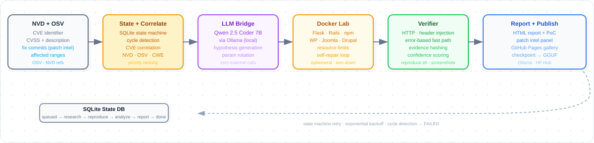
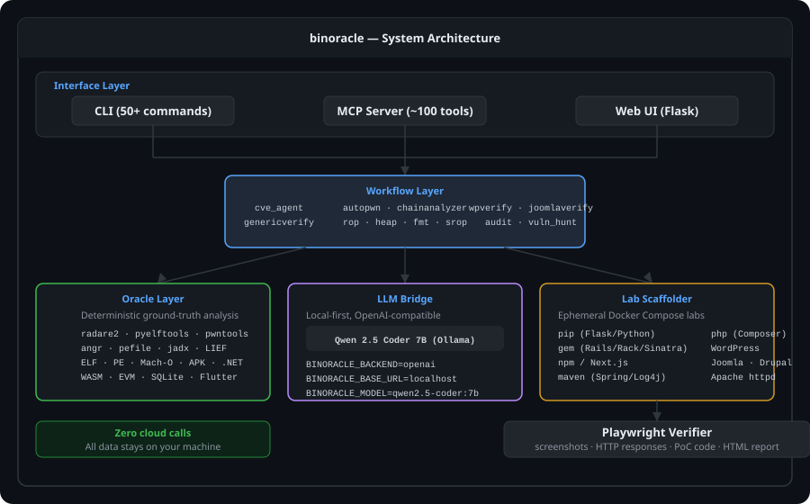

<div align="center">


# binoracle

**Autonomous CVE exploit research and binary reverse engineering — fully local**

[](https://pypi.org/project/binoracle/)
[](https://www.python.org/downloads/)
[](LICENSE)
[](https://beafn28.github.io/binoracle/)

[English](README.md) · [Español](docs/README.es.md) · [Docs](https://beafn28.github.io/binoracle/) · [Architecture](docs/assets/architecture.svg)

</div>

---

> **Legal notice** — binoracle is a research and educational tool.
> All CVE labs run exclusively against Docker containers you provision locally.
> Do not use this tool against systems you do not own or lack explicit written authorization to test.

---

## Overview

binoracle is a local-first security research assistant with two independent analysis pipelines:

| Pipeline | Function |
|----------|----------|
| **CVE Engine** | Retrieves a CVE descriptor from NVD, submits it to a local LLM (Qwen 2.5 Coder 7B via Ollama) which autonomously generates exploit hypotheses without external hints, provisions an ephemeral Docker Compose lab, executes the proof-of-concept against it, captures Playwright screenshots at each verification step, and emits a structured HTML report. |
| **Binary RE Engine** | Static and dynamic analysis of ELF, PE, Mach-O, APK, WASM, Go, Rust, .NET, JS, EVM, and SQLite artifacts. Covers exploit generation (stack, heap, format string, SROP), ROP chain synthesis, decompilation via multiple backends, and hardening assessment. All operations are local. |

No data leaves the host. The LLM runs via the Ollama OpenAI-compatible API at `localhost:11434`. Docker labs are torn down after each run. Reports are written to disk.

---

## Quick Start

```bash
# Install
pip install binoracle

# Install Ollama and pull the model (Linux / macOS)
curl -fsSL https://ollama.com/install.sh | sh
ollama pull qwen2.5-coder:7b

# Configure the LLM backend
export BINORACLE_BACKEND=openai
export BINORACLE_BASE_URL=http://127.0.0.1:11434/v1
export BINORACLE_MODEL=qwen2.5-coder:7b

# Run the CVE engine
binoracle cve CVE-2025-27516

# Static analysis on a binary
binoracle triage ./target_binary

# Full exploit chain
binoracle pwn ./vulnerable_binary
```

---

## CVE Engine

The engine is fully autonomous: the local LLM receives only the NVD description and no analyst-supplied hints. All exploit hypotheses are generated from that description alone.



### Supported vulnerability classes

| Class | Scaffolders | Automated PoC |
|-------|------------|-------------- |
| SSTI (Jinja2, Twig, Smarty) | pip / gem | yes |
| SQLi (GET / POST / JSON / header) | pip / gem / php / maven | yes |
| Path traversal / LFI | pip / gem / npm / httpd | yes |
| RCE / command injection | pip / gem / npm | yes |
| XSS (reflected / stored) | pip / npm | yes |
| SSRF | pip / npm | yes |
| XXE | java / maven | yes |
| Deserialization | java / gem (Marshal) | yes |
| Auth bypass / IDOR | pip / gem / npm | yes |
| File upload / webshell | pip | yes |
| Open redirect | pip / gem / npm | yes |
| CSRF | pip / gem | yes |
| WordPress plugins (100+) | WP Docker | yes |
| Joomla extensions | Joomla Docker | yes |
| Drupal modules | Drupal Docker | yes |
| Apache httpd | httpd Docker | yes |
| Java / Maven (Spring, Struts, Log4j) | maven | yes |
| PHP Composer packages | php | yes |
| npm / Node.js / Next.js | npm | yes |
| Ruby gems (Rails, Rack, Sinatra) | gem | yes |

```bash
# Single CVE
binoracle cve CVE-2025-27516

# Batch, parallelized
binoracle cve-batch CVE-2025-27516 CVE-2024-23334 CVE-2025-59681

# Report language override
binoracle cve CVE-2025-27516 --lang en
```

---

## Binary RE Engine

```bash
binoracle pwn ./binary
```

### Exploit families

| Family | Techniques |
|--------|----------- |
| Stack | ret2win, ret2libc, ret2plt, ret2csu, SROP (x86-64 / x86-32 / aarch64), stack pivot, ROP chains |
| Heap | tcache dup, fastbin dup, UAF, double-free, House-of-Force, House-of-Spirit, House-of-Orange, House-of-Mind, large-bin attack, unsafe-unlink, Botcake |
| Format string | %n arbitrary write, GOT overwrite, canary leak, PIE leak |
| Low-level | shellcode (NX off), bad-char scrubbing, IO_FILE exploit, DL-resolve, GOT hijack |
| Canary | leak + reuse, fork brute-force |
| PIE | partial overwrite, leak chain |

### Static analysis commands

```bash
binoracle triage ./binary        # mitigations, symbols, imports, sections
binoracle decompile ./binary     # multi-backend: Ghidra, radare2, angr, pwndbg
binoracle rop ./binary           # ROP gadget search + chain synthesis
binoracle chain ./binary         # full exploit chain generation
binoracle hardening ./binary     # NX, PIE, RELRO, canary, Fortify, CFI, shadow stack
```

### Supported formats

| Format | Analysis backends |
|--------|----------------- |
| ELF (x86-64 / x86 / ARM / MIPS / RISC-V) | radare2, pyelftools, pwntools, angr, pwndbg |
| PE / PE+ (Windows) | pefile, LIEF, radare2 |
| Mach-O (macOS / iOS) | LIEF, radare2 |
| APK / DEX (Android) | apktool, jadx, androguard |
| .NET assemblies | dnlib, ILSpy |
| JavaScript / TypeScript | esprima, acorn |
| Go binaries | go-dis stub, symbol recovery |
| Rust binaries | LIEF + symbol demangling |
| WASM modules | wabt, binaryen |
| SQLite databases | sqlite3 schema + data dump |
| EVM bytecode | pyevmasm |

---

## MCP Server

binoracle exposes its full capability set as MCP tools, enabling integration with Claude Desktop, Cursor, Zed, and other MCP-compatible clients.

```bash
binoracle mcp-server
```

```json
// claude_desktop_config.json
{
  "mcpServers": {
    "binoracle": {
      "command": "binoracle",
      "args": ["mcp-server"]
    }
  }
}
```

Available tools include: `triage`, `pwn`, `rop_chain`, `heap_exploit`, `fmt_exploit`, `decompile`, `cve_investigate`, `vuln_hunt`, `iocscan`, `hardening`, `audit`, `reachability`, `diff_patch`, `elf_layout`, `pe_inspect`, `apk_audit`, `dotnet_inspect`, `wasm_inspect`, `sqlite_audit`, `evm_inspect`, `fuzz`, `dynamic_trace`, `coredump`, and others (~100 total).

---

## CLI Reference

| Command | Description |
|---------|------------ |
| `triage` | Static facts: mitigations, symbols, imports, sections |
| `decompile` | Multi-backend decompilation with LLM annotation |
| `pwn` | Automated exploit chain (technique selected automatically) |
| `rop` | ROP gadget search and chain synthesis |
| `chain` | Chain analyzer: gadget enumeration, pwntools script generation |
| `heap` | Heap exploit primitives (tcache / fastbin / UAF / House-of-X) |
| `fmt` | Format string exploitation |
| `srop` | SROP chain generator |
| `shellcode` | Shellcode generator with bad-char filtering |
| `fuzz` | Dumb and smart fuzzer (AFL integration) |
| `dynamic` | Dynamic trace: strace, ltrace, gdb automation |
| `hardening` | Mitigation enumeration with bypass notes |
| `cve` | CVE investigation end-to-end |
| `cve-batch` | Batch CVE investigation (parallel) |
| `vuln-hunt` | Static vulnerability hunting (sinks, sources, taint) |
| `ioc-scan` | IOC and malware indicator scan |
| `audit` | Full security audit (all oracles + LLM synthesis) |
| `reachability` | Source-to-sink reachability analysis |
| `diff` | Patch diff and N-day analysis |
| `apk` | Android APK full audit |
| `dotnet` | .NET assembly inspection |
| `wasm` | WASM module inspection |
| `sqlite` | SQLite database audit |
| `evm` | EVM bytecode inspection |
| `mcp-server` | Start MCP server |
| `web` | Start web UI (localhost) |

---

## Architecture



---

## Reports

Each investigation produces an HTML report containing:

- Executive summary with CVSS score and severity classification
- LLM hypothesis with the full reasoning chain
- Lab scaffold configuration and Docker Compose specification
- Playwright screenshots at each verification step
- Complete PoC code (curl, Python, pwntools)
- Remediation recommendations with specific fix guidance

```bash
# Open the report after investigation
binoracle cve CVE-2025-27516 --open-report

# Write to a specific directory
binoracle cve CVE-2025-27516 --out ./reports/
```

---

## Practice Corpus

binoracle ships 40+ intentionally vulnerable binaries for local practice:

```bash
# Compile the corpus (requires Docker or gcc)
samples/build.sh

# Work through the tutorial
binoracle triage samples/bin/ret2win
binoracle pwn samples/bin/ret2libc
binoracle pwn samples/bin/format_string
# See docs/TUTORIAL.md for the full walkthrough
```

Techniques covered: ret2win, ret2libc, SROP, tcache dup, fastbin dup, UAF, format string GOT overwrite, canary leak, PIE leak, CSU chain, DL-resolve, heap botcake, house-of-orange, unsafe-unlink, stack pivot, IO_FILE, callhijack, dlresolve32.

---

## Installation

```bash
pip install binoracle
```

**From source:**

```bash
git clone https://github.com/beafn28/binoracle
cd binoracle
pip install -e ".[all]"
```

**Optional dependency sets:**

```bash
pip install binoracle[elf]         # deep ELF analysis (pyelftools extras)
pip install binoracle[pwn]         # pwntools + ROPgadget
pip install binoracle[symbolic]    # angr symbolic execution
pip install binoracle[web]         # web UI
pip install binoracle[screenshots] # Playwright screenshots in CVE reports
pip install binoracle[all]         # all of the above
```

**System requirements:**

| Dependency | Minimum | Recommended |
|-----------|---------|------------ |
| Python | 3.10 | 3.12 |
| RAM | 8 GB | 16 GB |
| Docker | 20.x | 25.x |
| Ollama | 0.3 | latest |
| GPU | — | 8 GB VRAM (Qwen 7B quantized) |

---

## Configuration

```bash
# Local LLM via Ollama (recommended)
export BINORACLE_BACKEND=openai
export BINORACLE_BASE_URL=http://127.0.0.1:11434/v1
export BINORACLE_MODEL=qwen2.5-coder:7b

# OpenAI-compatible cloud backend (optional)
export BINORACLE_BACKEND=openai
export BINORACLE_BASE_URL=https://api.openai.com/v1
export BINORACLE_API_KEY=sk-...
export BINORACLE_MODEL=gpt-4o-mini

# Report language (default: es)
export BINORACLE_LANG=en
```

---

## Comparison with REA

| Feature | binoracle | REA |
|---------|-----------|---- |
| Local LLM via Ollama | yes | no |
| CVE → Docker lab → verified PoC | yes | no |
| Playwright screenshots as evidence | yes | no |
| WordPress / Joomla / Drupal labs | yes | no |
| ret2win / ret2libc / SROP | yes | yes |
| Heap attacks (tcache / fastbin / UAF / House-of-X) | yes | yes |
| Format string exploitation | yes | yes |
| ROP chain synthesis | yes | yes |
| MCP server (~100 tools) | yes | no |
| Practice corpus (40+ binaries) | yes | yes |
| APK / .NET / WASM / EVM analysis | yes | partial |
| Fully offline | yes | partial |

---

## Roadmap

- Kernel exploit chains (ret2usr, UAF in kernel drivers)
- Firmware analysis (UEFI, embedded Linux)
- Active fuzzing with LibFuzzer corpus seeding from CVE PoCs
- Multi-CVE chaining (web RCE to local privilege escalation)
- CVSS v4 scoring
- Burp Suite MCP bridge (live request replay)
- JEB decompiler integration (Android native)
- Fine-tuned model for exploit hypothesis generation

---

## Contributing

```bash
git clone https://github.com/beafn28/binoracle
cd binoracle
pip install -e ".[all]"
pre-commit install
```

Pull requests welcome. See [CONTRIBUTING.md](CONTRIBUTING.md) for contribution guidelines.

---

## License

MIT © 2024–2025 Beatriz Fresno Naumova

---

<div align="center">

**binoracle — autonomous security research tool**

[Docs](https://beafn28.github.io/binoracle/) · [Issues](https://github.com/beafn28/binoracle/issues)

</div>
