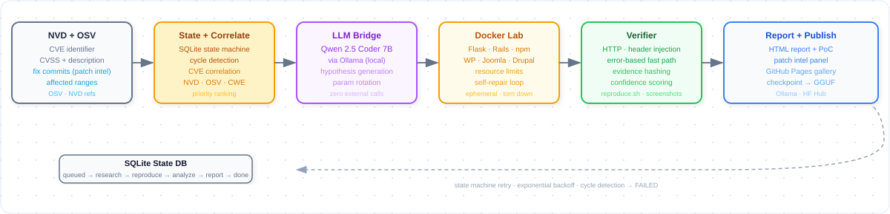
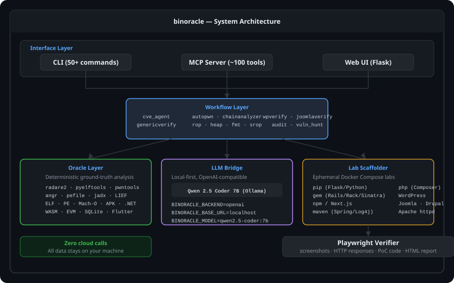

<div align="center">


# binoracle

**Investigacion autonoma de exploits CVE y reversing binario &mdash; 100 % local, ningun dato sale de tu maquina**

[](https://www.python.org/downloads/)
[](../LICENSE)
[](https://beafn28.github.io/binoracle/)
[](https://ollama.com)
[](https://www.docker.com)

[English](../README.md) &middot; [Espanol](README.es.md) &middot; [Documentacion](https://beafn28.github.io/binoracle/) &middot; [Arquitectura](assets/architecture.svg)

</div>

---

> **Aviso legal** &mdash; binoracle es una herramienta de investigacion y educacion.
> Todos los laboratorios CVE se ejecutan contra contenedores Docker que tu mismo aprovisionas localmente.
> No la uses contra sistemas que no sean tuyos o para los que no tengas autorizacion escrita explicita.

---

## Instalacion

```bash
pip install binoracle
curl -fsSL https://ollama.com/install.sh | sh && ollama pull qwen2.5-coder:7b

export BINORACLE_BACKEND=openai
export BINORACLE_BASE_URL=http://127.0.0.1:11434/v1
export BINORACLE_MODEL=qwen2.5-coder:7b
```

---

## Dos motores, una herramienta

<table>
<tr>
<th width="50%">Motor CVE</th>
<th width="50%">Motor RE Binario</th>
</tr>
<tr>
<td valign="top">

Dale a binoracle un identificador de CVE. Obtiene el descriptor de NVD, se lo pasa a **Qwen 2.5 Coder 7B local** (via Ollama), que genera hipotesis de exploit de forma autonoma &mdash; sin pistas del analista. Luego levanta un laboratorio Docker Compose efimero, lanza el PoC contra el, captura capturas de pantalla con Playwright en cada paso y escribe un informe HTML estructurado en disco.

```bash
binoracle cve CVE-2025-27516
binoracle cve CVE-2025-27516 --lang es --open-report
binoracle cve-batch CVE-2025-27516 CVE-2024-23334
```

</td>
<td valign="top">

Dale a binoracle un binario. Ejecuta analisis estatico y dinamico (ELF, PE, Mach-O, APK, WASM, Go, Rust, .NET, JS, EVM, SQLite), selecciona la tecnica de exploit adecuada, genera un script pwntools funcional e informa de las mitigaciones y estrategias de bypass.

```bash
binoracle triage    ./binario
binoracle pwn       ./binario
binoracle decompile ./binario
binoracle rop       ./binario
binoracle hardening ./binario
```

</td>
</tr>
</table>

---

## Motor CVE



```
NVD  -->  LLM local  -->  hipotesis  -->  lab Docker  -->  PoC  -->  informe HTML
          Qwen 2.5      sin pistas     entorno efimero  Playwright   solo en disco
```

El LLM recibe unicamente la descripcion cruda de NVD. Todas las hipotesis de exploit se generan a partir de esa descripcion, sin ninguna pista ni guia externa.

### Cobertura de vulnerabilidades

| Clase | Ecosistemas | Auto PoC |
|-------|------------|----------|
| SSTI | Jinja2, Twig, Smarty | si |
| SQLi (GET / POST / JSON / cabecera) | Python, Ruby, PHP, Java | si |
| Path traversal / LFI | Python, Ruby, Node, httpd | si |
| RCE / inyeccion de comandos | Python, Ruby, Node | si |
| XSS (reflejado / almacenado) | Python, Node | si |
| SSRF | Python, Node | si |
| XXE | Java / Maven | si |
| Deserializacion | Java, Ruby (Marshal) | si |
| Bypass de autenticacion / IDOR | Python, Ruby, Node | si |
| Subida de ficheros / webshell | Python | si |
| Redireccion abierta | Python, Ruby, Node | si |
| CSRF | Python, Ruby | si |
| Plugins WordPress (100+) | WP Docker | si |
| Extensiones Joomla | Joomla Docker | si |
| Modulos Drupal | Drupal Docker | si |
| Apache httpd | httpd Docker | si |
| Spring / Struts / Log4j | Maven | si |
| Paquetes PHP Composer | PHP Docker | si |
| npm / Node.js / Next.js | Node Docker | si |
| Gems Ruby (Rails, Rack, Sinatra) | Ruby Docker | si |

---

## Motor RE Binario

### Tecnicas de exploit

| Categoria | Tecnicas |
|-----------|----------|
| Stack | ret2win, ret2libc, ret2plt, ret2csu, SROP (x86-64 / x86-32 / aarch64), stack pivot |
| Heap | tcache dup, fastbin dup, UAF, double-free, House-of-Force, House-of-Spirit, House-of-Orange, House-of-Mind, large-bin attack, unsafe-unlink, Botcake |
| Format string | escritura arbitraria con %n, sobrescritura GOT, fuga de canary, fuga de PIE |
| Bajo nivel | shellcode (NX off), limpieza de bad-chars, IO_FILE, DL-resolve, secuestro GOT |
| Bypass de canary | fuga + reutilizacion, fuerza bruta en fork |
| Bypass de PIE | sobrescritura parcial, cadena de fugas |

### Formatos soportados

| Formato | Backends |
|---------|----------|
| ELF (x86-64 / x86 / ARM / MIPS / RISC-V) | radare2, pyelftools, pwntools, angr, pwndbg |
| PE / PE+ (Windows) | pefile, LIEF, radare2 |
| Mach-O (macOS / iOS) | LIEF, radare2 |
| APK / DEX (Android) | apktool, jadx, androguard |
| Ensamblados .NET | dnlib, ILSpy |
| Binarios Go | go-dis, recuperacion de simbolos |
| Binarios Rust | LIEF + demangling de simbolos |
| Modulos WASM | wabt, binaryen |
| Bytecode EVM | pyevmasm |
| SQLite | volcado de esquema + datos |

---

## Informes

Cada investigacion CVE y cada analisis binario genera un informe HTML autocontenido:

| Seccion | Contenido |
|---------|-----------|
| Resumen ejecutivo | Puntuacion CVSS, severidad, componente afectado |
| Hipotesis | Cadena de razonamiento completa del LLM |
| Laboratorio | Especificacion Docker Compose, versiones de servicios |
| Evidencia | Capturas de pantalla Playwright en cada paso de verificacion |
| PoC | Codigo completo curl / Python / pwntools |
| Remediacion | Guia de correccion especifica con ejemplos de codigo |

```bash
binoracle cve CVE-2025-27516 --open-report
binoracle cve CVE-2025-27516 --out ./informes/
binoracle cve-batch CVE-2025-27516 CVE-2024-23334 --out ./informes/
```

---

## Integracion MCP

binoracle funciona como servidor MCP, exponiendo el kit completo (~100 herramientas) a cualquier cliente compatible.

```bash
binoracle mcp-server
```

```json
{
  "mcpServers": {
    "binoracle": {
      "command": "binoracle",
      "args": ["mcp-server"]
    }
  }
}
```

<details>
<summary>Todas las herramientas MCP</summary>

`triage` `pwn` `rop_chain` `heap_exploit` `fmt_exploit` `decompile` `cve_investigate` `vuln_hunt` `iocscan` `hardening` `audit` `reachability` `diff_patch` `elf_layout` `pe_inspect` `apk_audit` `dotnet_inspect` `wasm_inspect` `sqlite_audit` `evm_inspect` `fuzz` `dynamic_trace` `coredump` `shellcode` `srop_chain` `got_hijack` `io_file` `dlresolve` `canary_leak` `pie_leak` `format_string` `heap_triage` `heap_tcache` `heap_fastbin` `heap_uaf` `heap_house` `stack_pivot` `ret2csu` `ret2plt` `ret2libc` `ret2win` `rop_search` `symbol_recovery` `import_scan` `export_scan` `section_dump` `string_extract` `entropy_scan` `yara_scan` `cve_batch` `vuln_classify` `patch_diff` `n_day_analysis` `cwe_map` `cvss_score` `exploit_db_search` `lab_provision` `lab_teardown` `lab_exec` `playwright_capture` `report_generate` `report_open` `web` y mas

</details>

---

## Referencia de comandos

| Comando | Descripcion |
|---------|-------------|
| `triage` | Mitigaciones, simbolos, importaciones, secciones |
| `decompile` | Ghidra / radare2 / angr / pwndbg + anotacion LLM |
| `pwn` | Cadena de exploit completa, tecnica seleccionada automaticamente |
| `rop` | Busqueda de gadgets ROP y sintesis de cadenas |
| `chain` | Enumeracion de gadgets + script pwntools |
| `heap` | Primitivas de exploit heap (tcache / fastbin / UAF / House-of-X) |
| `fmt` | Explotacion de format string |
| `srop` | Generador de cadenas SROP |
| `shellcode` | Shellcode con filtrado de bad-chars |
| `fuzz` | Fuzzer simple e inteligente (integracion AFL) |
| `dynamic` | strace / ltrace / automatizacion gdb |
| `hardening` | Auditoria de mitigaciones con notas de bypass |
| `cve` | Pipeline CVE completo: obtener -> lab -> PoC -> informe |
| `cve-batch` | Pipeline CVE por lotes, paralelizado |
| `vuln-hunt` | Analisis de taint estatico (sinks, sources) |
| `ioc-scan` | Escaner de IOC e indicadores de malware |
| `audit` | Todos los oraculos + sintesis LLM |
| `reachability` | Alcanzabilidad source-to-sink |
| `diff` | Diff de parche y analisis N-day |
| `apk` | Auditoria completa de APK Android |
| `dotnet` | Inspeccion de ensamblados .NET |
| `wasm` | Inspeccion de modulos WASM |
| `sqlite` | Auditoria de esquema y datos SQLite |
| `evm` | Inspeccion de bytecode EVM |
| `mcp-server` | Iniciar servidor MCP |
| `web` | Iniciar interfaz web local |

---

## Arquitectura



---

## Corpus de practica

40+ binarios vulnerables para practicar explotacion local:

```bash
samples/build.sh                                # compilar con Docker o gcc
binoracle pwn samples/bin/ret2libc
binoracle pwn samples/bin/tcache_dup
binoracle pwn samples/bin/house_of_orange
binoracle pwn samples/bin/format_string
```

Cobertura: ret2win, ret2libc, SROP, tcache dup, fastbin dup, UAF, sobrescritura GOT por format string, fuga de canary, fuga de PIE, cadena CSU, DL-resolve, heap botcake, house-of-orange, unsafe-unlink, stack pivot, IO_FILE, callhijack, dlresolve32.

---

## Configuracion

```bash
# LLM local via Ollama (recomendado, 100 % offline)
export BINORACLE_BACKEND=openai
export BINORACLE_BASE_URL=http://127.0.0.1:11434/v1
export BINORACLE_MODEL=qwen2.5-coder:7b

# Backend en la nube compatible con OpenAI (opcional)
export BINORACLE_BACKEND=openai
export BINORACLE_BASE_URL=https://api.openai.com/v1
export BINORACLE_API_KEY=sk-...
export BINORACLE_MODEL=gpt-4o-mini

# Idioma del informe
export BINORACLE_LANG=es    # por defecto: es
```

**Conjuntos de dependencias**

```bash
pip install binoracle[elf]         # pyelftools extras
pip install binoracle[pwn]         # pwntools + ROPgadget
pip install binoracle[symbolic]    # angr
pip install binoracle[screenshots] # Playwright
pip install binoracle[all]         # todo
```

**Requisitos del sistema**

| | Minimo | Recomendado |
|-|--------|-------------|
| Python | 3.10 | 3.12 |
| RAM | 8 GB | 16 GB |
| Docker | 20.x | 25.x |
| Ollama | 0.3 | latest |
| GPU | &mdash; | 8 GB VRAM |

---

## Que diferencia a binoracle

| Capacidad | binoracle | REA |
|-----------|:---------:|:---:|
| Pipeline autonomo CVE (NVD -> lab -> PoC) | si | no |
| LLM local via Ollama | si | no |
| Laboratorios Docker efimeros por CVE | si | no |
| Evidencia Playwright en los informes | si | no |
| Scaffolding WordPress / Joomla / Drupal | si | no |
| Servidor MCP (~100 herramientas) | si | no |
| Analisis APK / .NET / WASM / EVM | si | parcial |
| Operacion 100 % offline | si | parcial |
| Cadenas de exploit stack / heap / format string / SROP | si | si |
| Sintesis de cadenas ROP | si | si |
| Decompilacion multi-backend | si | si |
| Corpus de practica | si | si |

---

## Hoja de ruta

- [ ] Cadenas de exploit de kernel (ret2usr, UAF en drivers)
- [ ] Analisis de firmware (UEFI, Linux embebido)
- [ ] Corpus LibFuzzer sembrado desde PoC de CVE
- [ ] Cadenas multi-CVE (RCE web -> escalada de privilegios local)
- [ ] Puntuacion CVSS v4
- [ ] Puente Burp Suite MCP
- [ ] Decompilador JEB (Android nativo)
- [ ] Modelo ajustado para generacion de hipotesis de exploit

---

## Contribuir

```bash
git clone https://github.com/beafn28/binoracle
cd binoracle && pip install -e ".[all]" && pre-commit install
```

Consulta [CONTRIBUTING.md](../CONTRIBUTING.md) para las directrices de contribucion.

---

## Licencia

MIT &copy; 2024&ndash;2026 Beatriz Fresno Naumova

---

<div align="center">

[Documentacion](https://beafn28.github.io/binoracle/) &middot; [Issues](https://github.com/beafn28/binoracle/issues) &middot; [English](../README.md)

</div>
